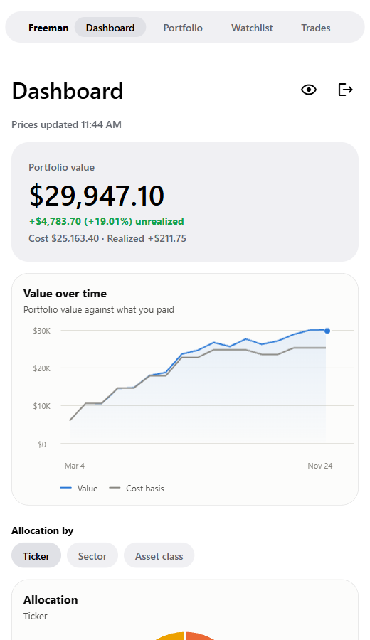
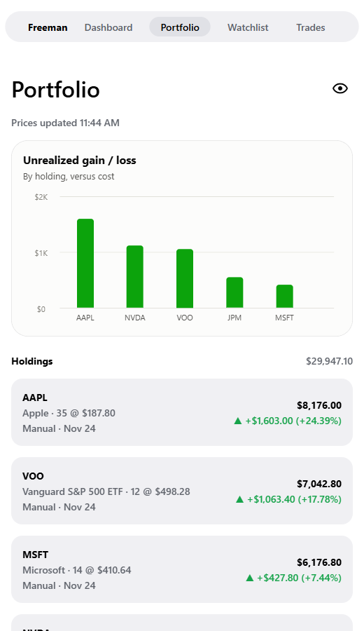
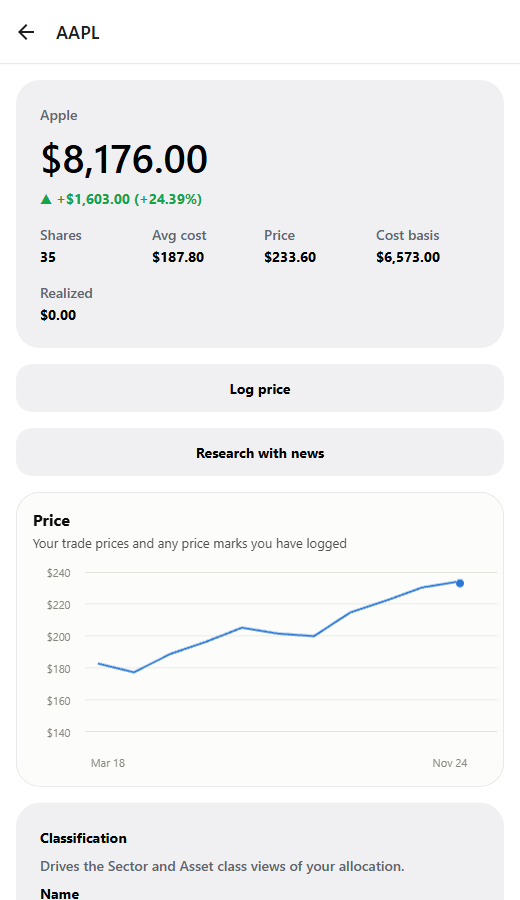
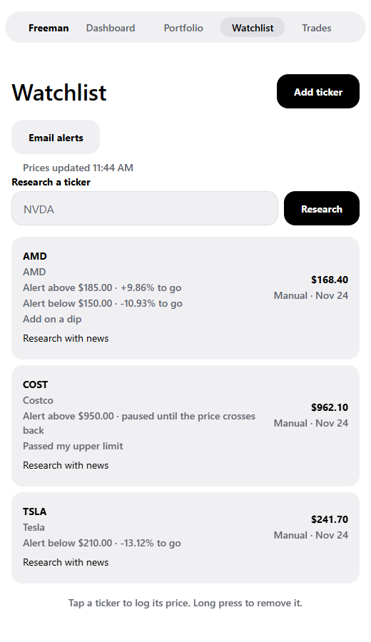

# Freeman

A personal stock portfolio tracker. Log buys and sells, see allocation, value over time and gain or
loss, and keep a watchlist that emails you when a price reaches a limit you set.

An Expo (React Native) app with its own FastAPI + Turso backend in [`api/`](api/README.md).

<table>
  <tr>
    <td align="center"></td>
    <td align="center"></td>
  </tr>
  <tr>
    <td align="center">Dashboard</td>
    <td align="center">Portfolio</td>
  </tr>
  <tr>
    <td align="center"></td>
    <td align="center"></td>
  </tr>
  <tr>
    <td align="center">Position</td>
    <td align="center">Watchlist and price alerts</td>
  </tr>
</table>

_Screenshots are from the web build with made-up sample data._

## Features

- **Portfolio math on the server:** average cost, unrealized and realized gain, value over time, and
  allocation by ticker, sector or asset class. A sale larger than the shares held is rejected.
- **Prices:** market quotes from Finnhub, refreshed when the app opens, or prices you enter yourself.
  Each price shows where it came from and when, and old ones are marked stale.
- **Email price alerts:** an upper and a lower limit per watchlist stock. The server checks them every
  two minutes and emails once when a limit is reached ([how it behaves](api/README.md#price-alerts)).
- **News analysis (optional):** a buy / hold / sell lean on a ticker, written by an OpenAI model from
  recent headlines. Every claim must cite a headline that was actually fetched. Not financial advice.
- **Accounts:** several users, each seeing only their own data. Argon2id password hashes, short-lived
  access tokens and single-use refresh tokens.
- **Everyday details:** hide-balances mode, the last data stays available offline, unsaved trade
  drafts are kept, and an error in one chart does not take down the screen.

## Tech stack

| Part | Built with |
| --- | --- |
| App | Expo SDK 58, React Native, TypeScript, Expo Router, TanStack Query, Zustand, react-native-gifted-charts |
| API | FastAPI, Pydantic, Turso (libSQL) |
| Quality | Jest and Testing Library, pytest, ESLint, Prettier, GitHub Actions |

How the code is laid out: [docs/architecture.md](docs/architecture.md). Rules for new code:
[docs/conventions.md](docs/conventions.md).

## Status

- The screenshots show the web build. **The current version has not yet been tested on a phone or in a
  store build.**
- Price alerts run inside the API server, so they work only while it is running. Run one server
  process, or each one sends its own emails.
- It is built for personal use. Keep registration off (the default) unless you add the protections
  listed in the [API notes](api/README.md#price-alerts).

## Run it locally

You need Node 22 and Python 3.13 (the versions CI uses).

**1. API** (from `api/`; paths are for Windows, use `.venv/bin/` elsewhere):

```bash
python -m venv .venv
.venv/Scripts/pip install -r requirements.txt
cp .env.example .env                     # set JWT_SECRET (at least 32 characters)
.venv/Scripts/python -m scripts.create_user you@example.com
.venv/Scripts/python -m uvicorn app.main:app --host 0.0.0.0 --port 8000
```

For the web app, also set `CORS_ORIGINS=http://localhost:8081` in `api/.env`. Market prices, email
alerts and news analysis are optional; [`api/README.md`](api/README.md) lists what each one needs.

**2. App** (from the repository root). Create `.env.local` (git-ignored):

```
EXPO_PUBLIC_API_URL=http://localhost:8000
```

On a phone, use your computer's network address instead of `localhost`. `EXPO_PUBLIC_*` values are
bundled into the app and readable by anyone who has it, so never put a secret in one. The app holds no
API key: access to data is by signing in.

```bash
npm install
npx expo start        # press w for web
```

## Tests and checks

```bash
npm run typecheck     # tsc --noEmit
npm run lint          # expo lint
npm run format:check  # Prettier (npm run format fixes it)
npm test              # Jest, fast, no coverage
npm run test:ci       # Jest with the coverage thresholds (what CI runs)
cd api && .venv/Scripts/python -m pytest -q
```

CI runs the API tests, then type checking, lint, formatting and the app tests with coverage.

- Screen tests live in `src/__tests__/`; other tests sit next to their code. Keep test files out of
  `src/app/`, because every file there becomes a route.
- `src/test-utils/` has `renderWithClient` (a fresh React Query client per test) and typed fixtures.
- App tests mock the API and the router, and API tests use a temporary database and fake providers, so
  neither touches the network.
- **Route types gotcha.** `expo lint`, `expo export` and `expo install` rewrite the generated
  `.expo/types/router.d.ts` in a form that makes `tsc` reject `"/"`. Start the dev server once
  (`npx expo start`) to regenerate it, then run `tsc`.
- To make `git blame` skip the repo-wide formatting commit, run once:
  `git config blame.ignoreRevsFile .git-blame-ignore-revs`.

**End-to-end flows (Maestro).** `.maestro/` has a smoke test of every tab and add-then-delete flows
for trades and the watchlist. They need an emulator or device, so CI does not run them. They write to
whatever API the app points at: use a test API, not your real data.

```bash
# install: https://docs.maestro.dev/getting-started/installing-maestro
npx expo run:android            # or run:ios, or install a development build from EAS
maestro test -e APP_ID=<your app's package or bundle id> .maestro
```

## App state

Server data lives in TanStack Query, and its cache is saved on the device so the app opens with the
last known data. Settings and drafts live in two small Zustand stores in `src/stores/`:

| Store | What it keeps |
| --- | --- |
| `preferences` | **Hide balances** (masks every amount and share count; percentages and market prices stay visible), the allocation view, the Trades filter, and the starting value of "Use my position" |
| `trade-draft` | The add-trade form, so a dismissed screen or a closed app loses nothing |

The app waits for both stores before drawing a screen, so hidden balances never flash. Format money
through `useMoney()` (`src/hooks/use-money.ts`) so it respects that setting.

## Builds (EAS)

`eas.json` has `development`, `preview` and `production` profiles. EAS builds do not read
`.env.local`, and a build used away from home needs the API hosted somewhere reachable. Setup, staged
rollout and rollback are in [docs/releasing.md](docs/releasing.md).

## Troubleshooting

**`UnavailabilityError` ("The method or property X is not available on android").** The native code
in the app on your phone does not match the JavaScript package. Update Expo Go from the store. If it
persists, build a development client: `eas build --profile development --platform android`. Haptics
go through `src/lib/haptics.ts`, which never throws; use it for any new haptic feedback.

## License

[Apache License 2.0](LICENSE)
